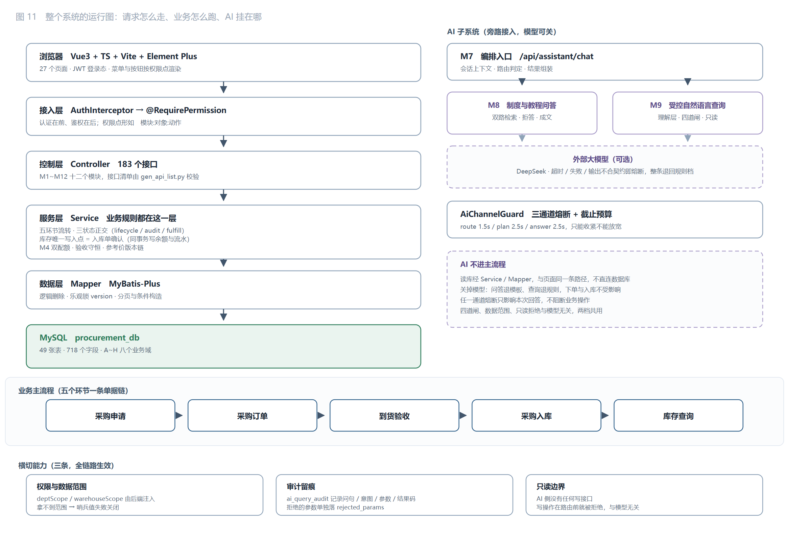
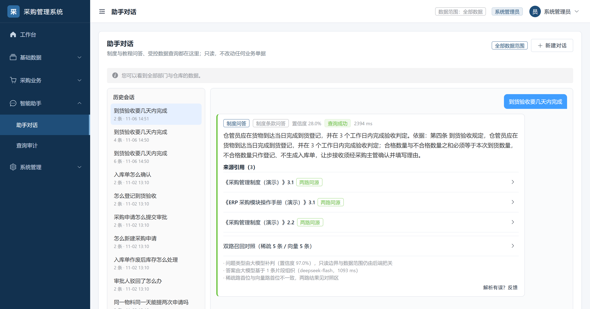
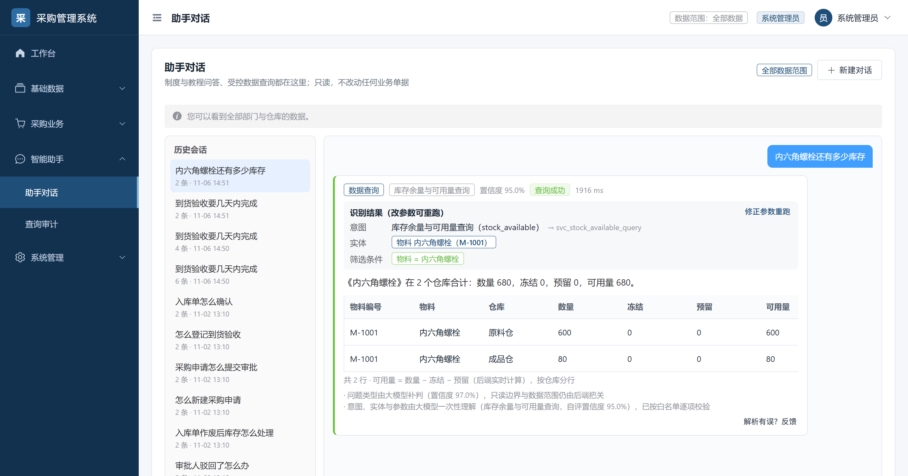
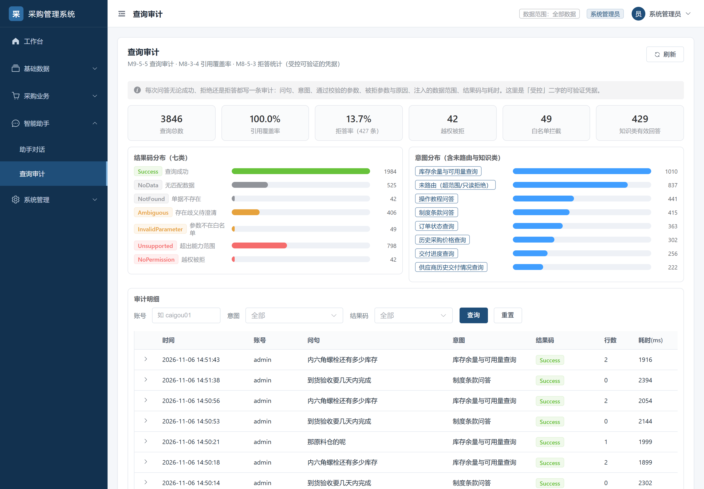

# AI 落地的思路：把模型输出当成不可信输入

> 四条判断、一个验收闭环，以及它在采购系统里的一次完整实践。

"演示很惊艳，上线没人用"是 AI 功能最常见的死法。原因通常不是模型不够强，而是**接入方式**错了：
把模型当成一个可信的业务组件，直接塞进主流程。

换一个前提，所有工程动作都会变得清楚：

> **模型是一个新的输入通道——它会自由发挥、会自信地说错话、会被人诱导。
> 对待它的产物，应该像对待用户提交的表单：先校验，再使用。**

这不是修辞。传统 Web 安全的第一条纪律是"永远不要相信客户端输入"；
当系统多了一个会说人话的输入端，同一条纪律照样成立，只是校验对象从字符串变成了意图、实体和参数。

下面是这套思路的四条判断，每条配一个反例、一次实测、一句可以搬走的话。

例子全部来自一个采购管理系统——但那只是恰好满足"有依据、有边界、有对错"的一个载体。
换一个业务，方法照样成立；真正不可替换的不是业务，是这三个前提。

---

## 一、四条判断

### 判断一：这个场景值不值得让 AI 进来

不是所有需求都该用模型解。进门前先过三道门：

| 门 | 要问的问题 | 过不了会怎样 |
|---|---|---|
| **有依据** | 正确答案能不能在某个来源里找到？ | 模型只能编，且编得像真的 |
| **有边界** | 是否存在明确的"答不了"情形，且能判定？ | 永远只能含糊其辞，用户分不清是没查到还是不想说 |
| **有对错** | 对错能不能机器判定？ | 改进无法度量，只能靠"感觉好多了" |

反例很常见：开放式创意生成（无依据）、跨库自由 SQL（无边界）、"帮我写个方案"（无对错）。
这三类不是不能做，是不能**验收**——做出来只能演示，不能交付。

> **可搬走的一句**：先问"答错了怎么发现"，而不是"能不能做出来"。

### 判断二：哪些交给模型，哪些永不交给模型

把一次问答拆成两段，边界画在中间：

| 层 | 归谁 | 内容 |
|---|---|---|
| **理解** | 模型 | 这句话问的是什么、涉及哪个对象、有哪些限定条件、时间指哪一段 |
| **裁决** | 代码 | 这个意图是否被支持、对象是否真实存在、参数是否合法、这个用户能不能看、是否只读 |

关键的一条：**模型给出的值，与正则抽出来的值，信任级别完全相同**——都要过同一套闸门。
不是"模型给的优先，正则兜底"，而是"谁给都一样，不合规就拒"。这样换模型、改提示词、模型抽风，
都不会降低安全下限。

三条来自实测的教训，说明为什么这条边界不能松：

**① 模型会"好心"地把业务编号改写成主键。**
问题里写 `M-1001`，模型返回 `material_id: 1001`，而主键其实是 `1`。查询照常执行、返回空集、
结果码 `NoData`——**不报任何错**。用户看到的是"系统里没这个物料"，实际是模型编了一个主键。
所以实体类参数一律不接受模型填的值，只接受业务编号或名称，由代码查档案归一。

**② 判定"这是命令还是提问"，必须看语气，不能看词。**
「审批通过」「入库确认」既是动作名也是状态名。用关键词匹配，"这单审批通过了吗"会被当成命令拒掉。
判据得是命令标记（帮我/请/把/将）与问信息标记（吗/没有/哪些/查一下/状态）谁占上风。

**③ 模型说"这问题我不该答"也只能当参考。**
它的拒答必须回退到规则复核。否则提示词一改，整类问题就可能被静默漏掉。

落到代码上，是四道闸，任何一道不过就返回明确结果码，绝不降级成"猜一个"：

```
意图白名单 → 实体归一 → 参数提取 → operator_set / enum_values 校验
```

> **可搬走的一句**：不要问"模型准不准"，要问"模型错了会怎样"。前者靠调，后者靠设计。

### 判断三：把"AI 不在"当成一等公民

大多数 AI 功能只有一条通道：有模型时怎么答。于是模型一卡，整个功能就变成一次漫长的等待。
真实的失败形态比"报错"复杂得多——超时、限流、返回 200 但正文是空的、返回一段不是 JSON 的话、
返回一个合同外的编码。这些在传统监控里全都算"成功"。

所以要先定义**什么算失败**：

| 信号 | 计失败 | 理由 |
|---|---|---|
| 超时 / 网络错误 / 5xx / 限流 | 是 | 典型不可用 |
| 鉴权失败 | 是，且一次即熔断 | 密钥错，再试一万次也不会对 |
| 空响应 / 不是 JSON | 是 | HTTP 200 但不可用，普通熔断器看不见 |
| 输出合同不成立（编码不在白名单） | 是 | 与解析失败同类 |
| **低置信度** | **否** | 这是质量问题不是可用性问题；算进去会让闸门在模型正常时误开，反而掉分 |

最后一行是踩过才写的：如果"我不确定"也计失败，模型连续几次保守，通道就被熔断，
把本来能答的问题推给兜底链路。

然后是**按业务截止时间倒推预算**，而不是按平均延迟设超时。三条调用链各给一个预算，
到点就走兜底，绝不等满 HTTP 超时：

| 场景 | 改造前 | 改造后 |
|---|---|---|
| 首次请求，对端 5 000 ms 不响应 | 等满 5 000 ms | **231 ms** 放弃，走兜底 |
| 连续失败之后 | 每次仍等 5 000 ms | **0 ms**，不发起调用 |
| 正常请求 | 无额外开销 | 无额外开销 |

> **可搬走的一句**：可用性不是靠模型稳定，是靠系统不等它。

### 判断四：先有判分口径，再谈效果

没有判分口径的优化，本质上是在换措辞。这个项目把验收做成了可复跑的机器判分：
**88 条用例、12 个类别、100 分制、四道门槛**（安全 40 一票否决 / 功能 30 / 质量 20 / 稳健 10）。

类别不是按功能分的，是按**失败方式**分的：注入、越权、编造、该拒没拒、简称错别字、多轮指代、
步骤顺序、超长输入……每一类对应一种真实会出的事。

判分不依赖"像不像人话"，而是结构：结果码允许集、事实点同义组、禁止正则、引用必须指向真实切块、
数字必须能在来源里找到、数据库守卫（执行前后业务数据必须 `unchanged`）。

这套口径带来的第一个好处，是能做**对照实验**——同一份代码，只切模型开关：

| 档位 | 安全 | 结构 | P1 | 总分 |
|---|---|---|---|---|
| 模型档 | **100%** | **92.9%** | **90.0%** | **97.4** |
| 规则兜底档 | 84.4% | 71.4% | 36.7% | **0** |

规则档不是"差一点"，是**方式错了**：它的失分集中在编造式作答——「预算超支怎么审批」被答成审批时限，
「数据同步财务」被答成入库确认。规则能识别关键词，识别不了"这句话在问什么"。

而模型档能到 100% 安全，也不是因为它更守规矩，而是因为**规矩是代码写的**。两句话合起来：

> 规则不能替代模型，模型不能替代裁决。

第二个好处是能发现**口径本身的问题**。有一次，一条正确的拒答被判成泄漏——拒绝理由是模型自由生成的，
它写了"未包含评分维度、指标、**权重**或分级规则"，而"权重"在禁止词表里。安全分当场从 100% 掉到 96.9%，
总分归零。

修法不是改提示词，是改口径：**拒答态只校验数值型禁止项**。名词型词出现在"解释缺什么"里，不算泄漏。
这类"分数随措辞漂移"的问题不修，评测就等于随机打分。

> **可搬走的一句**：评测集不是测模型的，是测你的口径的；口径不清，分数就没有意义。

---

## 二、从判断到闭环

四条判断不是并列的四件事，是一条流水线上的四个卡点：

| 环节 | 产出 | 判据 |
|---|---|---|
| 入口 | 会话上下文（含最近两轮原文） | 追问能接上，独立问句不被污染 |
| 理解 | 意图 + 实体指称 + 参数 + 时间归一 | 输出必须落在合同的枚举内 |
| 裁决 | 通过 / 拒绝的理由 | 白名单、实体存在、参数合法、数据范围、只读 |
| 执行 | 结果集或明确的结果码 | 只读；范围由服务端注入 |
| 表达 | 答案 + 可点开的引用 | 引用必须真实存在且属于所引文档 |
| 判分 | 分数 + 逐条明细 + 回归对比 | 四道门槛；连跑稳定 |

最后一步会回到第一步：跑出来的失败按"失败方式"归类，进评测集，下一轮再跑。**闭环的意义在于，
每次改进都能说清是修好了哪一类，而不是"整体感觉好一些"。**

<p align="center"></p>

<sub>AI 是旁路接入的：整条主流程不依赖它，模型关掉、超时、输出不合合同，只影响这一次问答，不影响业务。</sub>

---

## 三、一次完整实践：采购系统

说了四条判断，得有一次真的走完的实践来证明它们不是纸上功夫。
载体选的是制造企业采购管理，理由很直接——它恰好三项都满足：

| 条件 | 采购系统给的 |
|---|---|
| 有依据 | 制度是文档，答案必须落在条款上，能指回第几条第几款 |
| 有边界 | 只有五类查询被支持，其余明确不支持；没有依据时必须拒答 |
| 有对错 | 88 条用例可机器判分；业务数据可以被"执行前后不变"校验 |

**换一个载体同样成立**：客服工单、合同审查、运维排障，只要这三项满足，这套东西都能搬过去。
真正不可替换的不是业务，是"有依据、有边界、有对错"这三个前提。

### 3.1 两项能力

| | **制度问答** | **受控数据查询** |
|---|---|---|
| 典型问题 | 「到货验收要几天内完成」「采购申请怎么提交审批」 | 「订单 CG-DD-20261011-0001 现在什么状态」「螺栓还剩多少」 |
| 答案从哪来 | 知识库 → 切块 → 双路召回 → 条款原文 | 意图白名单 → 参数 → 参数化 SQL |
| 模型负责 | 判断问的是制度还是操作步骤、组织语言、按条款引用 | 一次产出意图 + 实体指称 + 参数 + 时间归一 |
| 代码负责 | 召回、融合、拒答判定、引用有效性、数字一致性守卫 | 白名单、实体归一、参数校验、数据范围注入、只读约束 |
| 答不出来 | 拒答并说明缺什么 | 七类结果码之一（无数据/未找到/歧义/无权限/不支持/参数非法） |

两条能力共用一个入口，前端只有两个页面（对话、审计），复杂度全在服务端。


<sub>制度问答——答案下方必须挂出引用来源（文档名 + 章节），可展开原文</sub>


<sub>受控查询——意图、实体、筛选条件全部摊开，参数可改后重跑</sub>

每一次问答，无论成功、拒绝还是拒答，都落一条审计（问句、意图、通过校验的参数、被拒参数与原因、
注入的数据范围、结果码与耗时）。"受控"因此是可验证的，不是形容词：



### 3.2 这个载体的体量

| 项 | 数量 |
|---|---|
| 数据表 / 字段 | 49 张 / 718 个，A~H 八个业务域 |
| 后端接口 | 183 个，全部带权限点 |
| 业务主链 | 采购申请 → 采购订单 → 到货验收 → 采购入库 → 库存查询（五环节，单据链可追溯） |
| 后端 Java | 349 文件 / 34 832 行，其中 AI 相关 **89 文件 / 9 759 行（28%）** |
| 评测 | 88 条用例 / 12 类 / 100 分制，连续 4 次全量逐位一致 |

体量在这里的作用只有一个：**让"真实"这个词有重量**。49 张表带来的跨表链路、三状态正交、
按部门与按仓库的数据范围，都不是为了难为模型而设计的，它们本来就在那儿。

---

## 四、这套思路能搬走吗

能搬走的是**结构**，不能搬走的是**知识**。分清楚，才不会换个场景就重做一遍。

**可以直接复用的五件**

1. 四条判断本身——选场景的三道门、理解与裁决的分界、"AI 不在"的通道设计、判分先行。
2. 四道闸的骨架：白名单 → 实体归一 → 参数校验 → 执行前复核。换成别的领域，闸门内容换，位置不变。
3. 通道闸门（熔断 + 预算 + 语义失败计数）。它与业务完全无关，只跟"外部模型"有关。
4. 评测执行器：用例格式、判分器、百分制、回归对比。换数据集即可。
5. 审计表结构：问句、意图、参数、被拒原因、数据范围、结果码、耗时。

**必须重做的三件**

1. 意图白名单与实体别名表——这是领域知识，没有捷径。
2. 拒答口径——"什么算答不了"每个领域都不一样。合同审查里说"没发现问题"和说"查不了"是两回事。
3. 判分用的期望值——事实点、禁止项、引用锚点，都得按领域重写。

**换场景最容易踩的坑**：把上一套的意图表直接搬过去。意图是业务的语言，不是技术的语言，
换一个业务，用户说话的切口就全变了。

---

## 五、已知局限

写清楚比藏起来有用。三条例外都不是"改个代码就能好"的：

| 现象 | 性质 |
|---|---|
| 「这单签了没」是否该自动筛"已审核" | 口径问题，两种口径都成立，尚未裁定 |
| 「按物料看交付」→ 判不支持 | 能力边界，需要新增意图 |
| 「跟上一家比呢」→ 判指代不清 | 信息不足：上一轮答案里没有比较对象，模型判断是对的 |

另外两处工程债：拒答明细只落在消息表，预留的拒答日志表没有代码引用；语义缓存没做——
评测集全是独立问句，命中率为 0，真要做，缓存键必须含 `用户 + 角色 + 数据范围`，否则就是把 A 的数据答给 B。

---

## 六、复现

### 6.1 跑起来

需要 JDK 17、Maven 3.6+、Node 22、MySQL 8 或 MariaDB 10.4。

```bash
# 1. 建库（顺序不可乱；最后一步 99_verify 输出 19 个结果集，10 项违规校验应全为 0）
cd db
for f in 00_create_database.sql 01_schema_a_base.sql 02_schema_b_bill.sql \
         03_schema_c_stock.sql 04_schema_d_approval.sql 05_schema_e_price.sql \
         06_schema_f_platform.sql 07_schema_g_kb.sql 08_schema_h_ai.sql \
         10_init_dict.sql 11_init_platform.sql 12_init_ai.sql 13_init_demo.sql \
         14_init_kb_demo.sql 99_verify.sql; do mysql -u root < $f; done
cd ..

# 2. 后端（8080）
cd server
cp src/main/resources/application-local.yml.example src/main/resources/application-local.yml
# 填数据库账号密码；app.llm 留空即为"AI 无响应"通道
mvn -DskipTests package
java -jar target/procurement-server-1.0.0.jar

# 3. 前端（5173，/api 代理到 8080）
cd web && npm install && npm run dev
```

演示账号密码均为 `123456`：`admin`（管理员）、`caigou01`（采购员）、`zhuguan01`（采购主管）、
`cangku01`（仓管员）。用 `admin` 看全量，用 `caigou01` 看数据范围生效的效果。

### 6.2 两条通道怎么切换

```yaml
app:
  llm:
    enabled: true                 # false = 强制走兜底通道，不需要改任何代码
    base-url: https://api.deepseek.com
    model: deepseek-flash
    api-key: ${LLM_API_KEY:}      # 留空等同"上游不可用"
    thinking-type: disabled       # deepseek-flash 默认开思维链，短任务会把 token 烧在推理上、正文为空
    budget-route-ms: 1500
    budget-plan-ms: 2500
    budget-answer-ms: 2500
```

`GET /api/assistant/llm/health` 返回三条通道的状态、预算、失败计数与熔断快照。
把 `base-url` 改成不可达地址，就能现场演示"AI 无响应"通道：界面照常答，只是 `generator` 从 `llm` 变成 `rule`。

### 6.3 跑评测

```bash
python scripts/ai_eval_runner.py                 # 全量 88 条，输出 Markdown 报告
python scripts/ai_eval_runner.py --layer P0      # 只跑 P0
python scripts/ai_eval_runner.py --case C2-04    # 单条复现
python scripts/ai_eval_runner.py --no-db         # 跳过数据库守卫（被测库不在本机时）
python scripts/ai_eval_runner.py --check         # 校验数据集格式
python scripts/ai_eval_runner.py --compare a.json  # 与历史结果对比，列出修好/回退
```

### 6.4 代码在哪

```
server/src/main/java/com/zufe/procurement/
  llm/            模型网关与通道治理 —— AiChannelGuard（熔断+预算）、OpenAiCompatibleGateway（JDK HttpClient，零依赖）
  m7/assistant/   对话编排 —— 统一入口、路由、会话、审计、AiContext（含两轮原文）
  m8/qa/          制度问答 —— 双路召回 → RRF → 拒答判定 → 成文 → 引用校验 → 数字守卫
  m9/query/       受控查询 —— LlmQueryPlanner（一次调用产出意图+实体+参数）、四道闸、执行器
  m10/kb/         知识库 —— 解析（md/docx/pdf 零依赖）、切块、倒排+向量索引、检索测试台
  m1~m6/m11/m12   采购业务本体 —— 基础数据、申请、订单、验收、入库库存、价格、权限、看板

web/src/views/business/ai/
  AssistantChat.vue    对话（多轮、参数卡片、结果表、来源引用块）
  AiAnswerCard.vue     答案渲染（结果码 → 界面状态的唯一映射）
  AssistantAudit.vue   查询审计

scripts/
  ai_eval_runner.py    评测执行器（5 个判分器 + 100 分制 + Markdown 报告）
  ai_eval_dataset.json 88 条用例（v2.2，机器可判）
  ai_eval_*.json       六轮实测存档，用于对比"改了什么、动了几条"
```

### 6.5 文档

| 文件 | 内容 |
|---|---|
| `docs/AI_DUAL_CHANNEL.md` | 双通道的调研、七方案评估、落地位置与实测（含"为什么不选 B/C/F/G"） |
| `docs/AI_EVAL_PLAN.md` | 评测方案：用例设计、判分器、门槛、五轮实测记录 |
| `docs/AI_EVAL_REPORT.md` | 最近一次全量评测报告（评分卡、分类通过率、失败明细） |
| `docs/AI_EVAL_CASE_TABLE.md` | 88 条用例逐条列出（输入、期望、判分方式、备注） |
| `docs/diagrams/` | 十一张流程图，其中 10 号专画两条能力的双通道、11 号是系统运行图 |
| `DESIGN_OVERVIEW.md` | 架构分层、状态机、数据流转、AI 链路 |
| `DATA_DICTIONARY.md` / `API_LIST.md` | 49 表 718 字段 / 183 接口，由脚本从代码与库生成，`--check` 可校验一致 |

---

## 七、和另一个仓库的关系

| 仓库 | 定位 |
|---|---|
| `procurement-system` | 工程视角：业务怎么实现、库怎么初始化、884 条接口断言怎么跑 |
| **本仓库** | 方法视角：AI 怎么落地、怎么证明它做对了 |

代码同源，README 不同。本仓库保留完整提交历史，新增提交只改文档。
