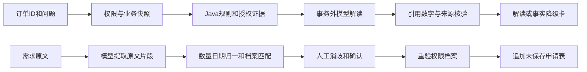

# 订单审查与采购需求起草助手

本功能展示“将 AI 接入已有业务任务”：复用订单、申请、物料和权限服务，增加证据编排、受约束生成、候选消歧与人工确认。模型不会审批、联系供应商或保存采购申请。所有样本均为虚构演示。

## 立即体验

完成迁移并启动后打开 `http://127.0.0.1:18080`，使用 **AI任务演示**账号 `ai_buyer / 123456`。范围为采购部、公共与AI演示产线项目；独立角色补充价格证据权限，不改变原采购员/主管授权。

1. 首页“审查订单”→打开 `AI-DEMO-ORDER-RISK` 详情→“AI订单审查”→提交。直接入口 `/order?orderId=81002&task=review`。
2. 首页“起草采购需求”或申请页“AI起草申请”。直接入口 `/request?task=draft`。示例只预填，需自己提交。
3. 模型关闭时，审查只展示事实/规则/候选制度，明确没有AI解读；起草只支持字段标签模板。自由文本不能解析时要求人工填写，不伪装生成。
4. 选具体规格，确认数量/单位、日期和归属，再“确认并追加”。只改变未保存表单，保留已有编辑。之后可补价格/供应商并通过原“保存”按钮提交；演示可直接取消。

```text
物料：AI演示螺栓；数量：二百；单位：件；需求日期：下周五；归属：公共
物料：AI-DEMO-CABLE；数量：30；单位：米；需求日期：明天；归属：公共
```

真实模型示例：“下周五需要二百件AI演示螺栓，用于公共领用。”配置 `LLM_ENABLED=true` 和可用的 `LLM_BASE_URL` / `LLM_MODEL` / `LLM_API_KEY`，复用 `LlmGateway`。本机已接入真实聊天模型，配置步骤见[发布说明](release.md)，开发场景结果见[真实调用记录](evaluation/runs/2026-11-09-ai-tasks-real-model/report.md)。

## 实现与取舍



**订单审查**：单张最多30行，用户选择全面/价格/交付，模型仅在给定证据内解读。服务层重验chat/data/order功能权限和部门范围；有显式归属范围时整单含外部归属即拒绝。价格参考、历史统计、制度分别检查权限。

参考价使用订单**创建日**有效版本，偏离/阈值复用业务算法。缺参考价/交期标未检查。历史价不使用全局快照：只取创建早于本单、同物料/单位/税率、已审批且未删除、授权范围内最近5条明细，数量加权。“成交”口径是已审批订单价格，不代表入库/付款或当前供应商报价。

BM25最多3个有效制度原文，标候选参考，不自动认定适用。模型最多6条解释，引用本轮整数编号，数字/单位只在实际引用文本中验证。短只读事务在请求模型前结束；模型预算6500ms，不自动重试。返回前重验权限、业务快照与制度哈希；来源变化标 `stale` 并清除解读。关闭、超时、限流、格式/引用/数字错误返回 `facts_only`，不生成模板结论。

**需求起草**：模型只提取原文物料/数量/单位/日期/归属片段，不采信模型ID。数字须完整，30不能截成3。后端支持明确小数、规范千位分隔、常用中文整数，最多4位小数；“两三百”“一百二”不猜。原新建表保持4位精度。按服务端Asia/Shanghai日期展开“下周五”，模糊日期留待确认。

仅匹配启用档案，同名规格需选择。不换算卷/米、箱/件；数量与档案单位必须人工确认。价格/供应商留空，归属仅给授权候选，未知对象不变为公共。确认接口接受本人1小时内、权限指纹未变的任务，重查档案和范围。保留人工编辑，仅移除完全未编辑的初始空行；同结果不能重复应用。异步输入变化或关闭对话框后不应用旧结果。

原申请保存仍是主表/明细多个API的人工操作，不宣称AI原子创建整单。原表单下拉和保存补上显式归属范围检查，防止确认后绕过。

**边界**：数字/引用守卫不能证明条件、例外、否定及归因正确，原文子串匹配不证明抽取语义正确，必须真实模型加人工评审。

## 接口与审计

| 接口 | 返回与用途 |
|---|---|
| `POST /api/assistant/tasks/orders/{id}/review` | `generated/facts_only/stale`，检查/解释/证据/缺口/快照 |
| `POST /api/assistant/tasks/request-draft` | `generated/rule_template/manual_required`，原文/候选/问题/服务端日期 |
| `POST /api/assistant/tasks/request-draft/validate` | 重验后的候选，不创建申请 |

`ai_task_run`记录用户、权限指纹、结果/确认JSON和时间，不改变聊天`answerMode`。没有对其他用户开放历史读取。响应记录模型、提示词版本、耗时及供应商返回的tokens。

## 测试数据

| 样本 | ID或编码 | 用途 |
|---|---|---|
| 同名螺栓 | 81001/81002，AI-DEMO-M8/M10 | M8×30/M10×40消歧 |
| 无参考价传感器 | 81003，AI-DEMO-SENSOR | 缺依据 |
| 电缆/停用件 | 81004/81005 | 单位冲突/停用拒绝 |
| 正常订单 | 81001，AI-DEMO-ORDER-NORMAL | 参考价一致，初始交期未来30天 |
| 风险订单 | 81002，AI-DEMO-ORDER-RISK | 18元对10元，偏离80%，初始逾期7天 |
| 缺依据订单 | 81003，AI-DEMO-ORDER-NOREF | 无参考价/交期/历史 |
| 外部门订单 | 81004，AI-DEMO-ORDER-FOREIGN | 部门拒绝 |
| 授权历史A/B | 81005/81006 | 100件×10元与300件×12元，均价11.5元 |
| 外部门/外归属历史 | 81007/81008 | 极端价999/800元不能污染统计 |
| 项目A/B | AI-DEMO-PRJ-A/B | 可见/不可见候选 |

共5种物料、8张订单、2个项目、1个账号。订单全部未入库/交付为0，没有伪造库存。日期相对首次迁移日生成，以后自然变化，不随重启重置。价格断言需样本未被人工修改。迁移04–07经ledger管理，重跑不覆盖编辑；07修复新增角色编码，迁移客户端显式utf8mb4。知识库和60题冻结集未变。

## 复现与实际结果

```powershell
docker compose exec -T db sh /workbench-deploy/migrate.sh
docker compose up --build -d backend web
python scripts/smoke_ai_tasks.py
python scripts/ai_task_eval_runner.py --check
cd server
.\mvnw.cmd verify
cd ..
python scripts/check_database_tests.py
# 配好真实模型后采集12条开发场景，默认新目录不覆盖旧结果
python scripts/ai_task_eval_runner.py --repeats 3
```

Windows JDK出现`Unable to establish loopback connection`时，本次以`JAVA_TOOL_OPTIONS`中的`-Djdk.net.unixdomain.tmpdir`指定已创建的较短工件目录解决；不能通过跳过测试来声称通过。

`TaskParserTest`验证原文/数字/日期/引用，`TaskFailureTest`使用模拟网关。`AiTaskIT`在独立MySQL容器验证权限过滤、跨用户/过期/停用、来源变化、原表单保存与业务表哈希守卫。HTTP冒烟走真实Nginx/Java/MySQL；浏览器验证消歧、追加、编辑保护与重复应用。

真实模型runner在模型关闭时拒绝执行。保存原始响应、机械断言、源码树/数据集哈希、HEAD和模型/语料manifest，语义评审状态始终待人工核对。12条是开发场景，不是保留集；机械通过率不是AI准确率。runner不执行数据库守卫，报告明确标记，数据库验证在集成测试单列。

2026-11-09本机：100项Java单元、14项MySQL集成通过且无跳过（新增43项单元、8项集成），新HTTP冒烟28/28。浏览器验证审查与离线填表，保留人工备注/数量、阻止重复应用；当前构建加载后控制台无错误。重建期间旧标签页分块资源失效，刷新后恢复。

以上100/14及浏览器记录为离线实现阶段。真实接入后修复公共领用别名与完整物料编码匹配，新增7项回归，全量107项Java单元、14项MySQL集成通过且无跳过。12条开发场景各3次：起草24/24生成，审查8/12生成、4次输出校验降级；生成占比不等于准确率，完整语义、人工修正量和效率对照仍待评审。[报告与原始响应](evaluation/runs/2026-11-09-ai-tasks-real-model/report.md)保留首轮失败，不覆盖历史。实现与报告随 `product/ai-workbench` 分支版本管理；报告仍保留采集时的工作区版本信息。
