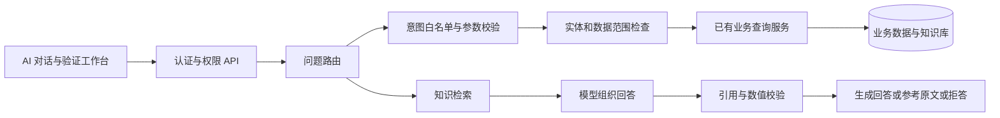

# 架构与取舍

架构围绕“给存量业务系统增加可验证的 AI 能力”组织。AI 交互、问题路由、受控查询、知识检索与答案校验构成改造层；采购服务、权限与 MySQL 构成业务基础。采购场景用于验证集成方法、权限继承和失败处理。

数据查询保留规则路径，无论模型还是规则提供参数，都由同一套意图、实体、参数、权限校验决定能否执行。制度问答不回退模板结论：模型关闭、超时、限流、异常 JSON、非法引用、数值不一致时只展示参考片段，检索依据不足时拒答。

数值守卫按完整数值与单位比较，支持千位分隔、小数、百分比和常见中文数词。万元与元明确换算；工作日不与自然日互换；条款编号与业务数量分别处理。校验语料仅来自本轮实际引用片段。这层校验不能证明结论完整保留条件、例外和否定意义。

语义嵌入配置位于 `app.embedding`。单次批量上限10条；在线查询默认1500毫秒，不同步重试。语义向量按切块 ID、配置指纹、模型、维度、预处理版本、内容哈希独立保存。指纹不含密钥。云端请求在事务外完成，独立 `SemanticIndexWriter` 事务代理锁定切块、复核内容哈希后提交。默认不自动构建语义索引。

普通检索出现语义索引不完整或云端异常时，整次回到 BM25＋哈希。检索测试默认严格模式，失败直接终止，不用回退结果冒充语义结果。四种策略保留相同启用语料候选，使用 RRF 融合排名，不直接相加 BM25 与余弦分数。

入库单编辑、确认、作废和删除草稿在完整事务内使用 `SELECT ... FOR UPDATE` 锁定单据行；更新同时限定原状态并检查影响行数。确认与作废的库存、流水及订单履约回写失败后整体回滚。删除草稿复用现有草稿维护权限 `m5:inbound:update`，不引入新权限编码。

选择 MySQL 全量向量候选是为了保持演示环境简单并能对照现有实现。大规模向量检索、流式输出、语义缓存、多 Agent 和 AI 写库不属于本版范围。
